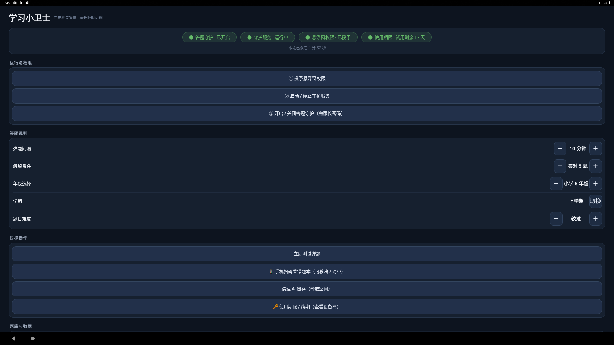
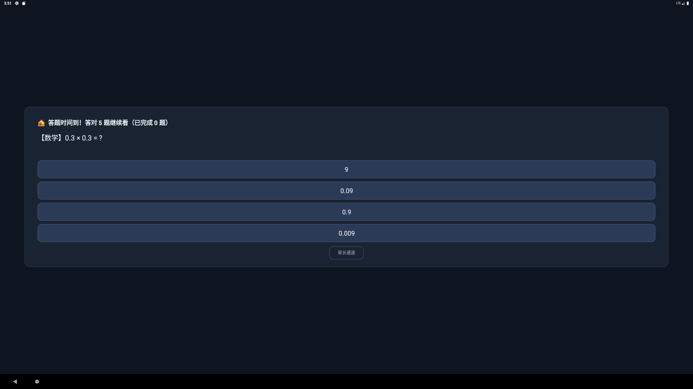
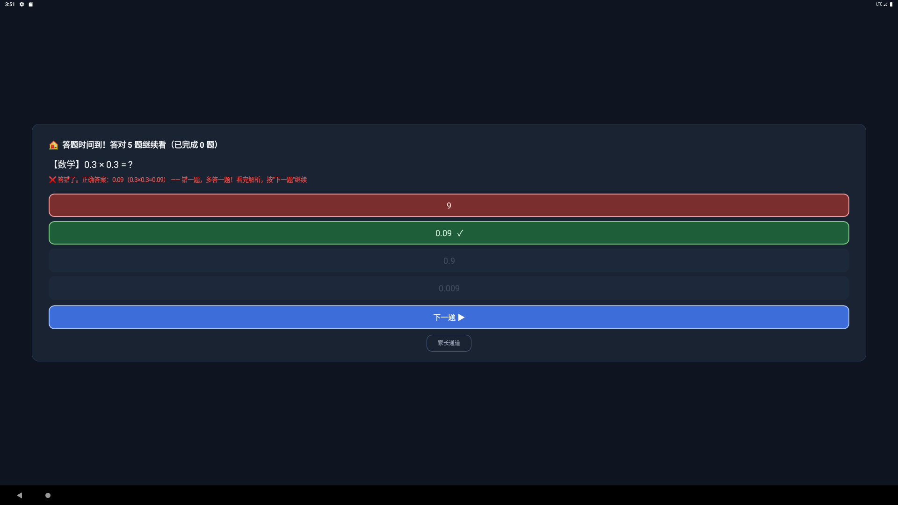
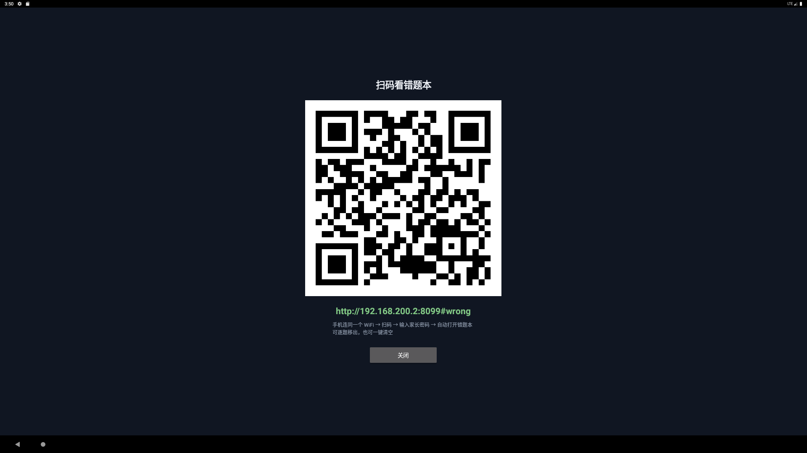

# 学习小卫士（QuizLockTV）— 电视答题守护

参考"爸爸魔改电视"的实现思路：孩子每看 10 分钟电视，全屏弹出五年级（语文/数学/英语）选择题，**答对 5 题才能继续看**；答错自动追加题目，错题进入错题本定期复现。

> 开源地址：<https://github.com/Luffys6/XTV> · 纯本地运行，不上传任何观看数据
>
> 源码公开，仅供学习交流，**禁止任何商业使用**（详见 [LICENSE](LICENSE)）。

## 界面预览

| 电视主界面（遥控器操作） | 答题弹窗（按 Home 也躲不掉） |
|---|---|
|  |  |

| 答错即时解析 | 手机扫码看错题本 |
|---|---|
|  |  |

## 技术栈

- 纯 Java + AndroidX（appcompat 1.2.0），零其他三方依赖
- AGP 4.0.2 / Gradle 6.8 / compileSdk 30 / targetSdk 30 / minSdk 21
- 不刷机、不改固件：利用 Android 悬浮窗（`TYPE_APPLICATION_OVERLAY`）盖在所有画面之上

## 核心机制

| 组件 | 说明 |
|---|---|
| `WatchMonitorService` | 前台服务，每秒累计"屏幕亮着"的秒数（弹题时暂停），到点弹题 |
| `QuizOverlay` | 全屏悬浮窗答题 UI，D-pad 遥控器可操作，按 Home 躲不掉 |
| `QuestionBank` | 每个年级一份 30 题的题库：内置题 `assets/questions/grade1~6.json` 播种 + AI 出的题滚动补进来，25% 概率抽错题本 |
| `Store` | SharedPreferences 持久化：观看计时 / 错题本 / 统计，**断电重启不清零** |
| `BootReceiver` | 开机自启，开机即弹题（堵住"断电重启"漏洞） |
| 家长通道 | 答题页底部输入家长密码才能退出，防孩子误触 |

规则：每答错 1 题追加 1 题，答对题数累计到设定值（默认 5）即解锁，观看计时清零。

## 安装与部署（ 电视）

```bash
git clone https://github.com/Luffys6/XTV.git
cd QuizLockTV
```

两种方式：**方式一 adb**（推荐，功能最全）、**方式二 U 盘**（无电脑 adb 环境时用，但悬浮窗权限仍需一次 adb 补做）。

### 方式一：adb 安装（推荐）

```bash
# 1. 编译 debug 包（Android Studio 打开项目直接点 Run，或命令行：）
#    项目里没有勾 gradlew，需本机装 Gradle 6.8 + JDK 8：
gradle assembleDebug
# 产物：app/build/outputs/apk/debug/app-debug.apk

# 2. 安装到电视
adb connect <电视IP>:5555
adb install -r app-debug.apk

# 3. 授予悬浮窗权限（电视上一般没有"显示在其他应用上层"的设置页，直接用 adb 最稳）
adb shell appops set com.family.quizlock SYSTEM_ALERT_WINDOW allow

# 4. 加入电池优化白名单，防止后台被杀
adb shell dumpsys deviceidle whitelist +com.family.quizlock

# 5. 打开 App（启动器里的"学习小卫士"），点"启动守护服务"，点"立即测试弹题"验证
```

### 方式二：U 盘安装（没有 adb 环境时）

适合在电视上直接操作，或在别人家的电视上部署：

1. **拷贝 APK**：把 `app/build/outputs/apk/debug/app-debug.apk` 拷到 U 盘根目录（可改名为 `quizlock.apk` 方便辨认），U 盘格式用 FAT32/exFAT 均可
2. **插入电视** USB 口
3. **打开 APK**：
   -  一般会自动弹出"检测到 U 盘"→ 打开 → 找到 APK 文件点安装
   - 没弹的话，进"我的应用"→ 找"**媒体中心 / 文件管理 / 电视管家**"类应用 → 进入 U 盘 → 点 APK 安装
4. **允许未知来源**：安装时若提示"禁止安装未知来源应用"，按提示去 设置 → 安全 → 允许安装未知来源（装完建议再关回去）
5. **装完先装回 U 盘保管**（以后重装/升级用）

⚠️ **U 盘安装装不出 adb 授权**，以下两项必须用电脑 adb 补做一次（任何能开 USB 调试/同一局域网的机器都行）：

```bash
adb connect <电视IP>:5555
adb shell appops set com.family.quizlock SYSTEM_ALERT_WINDOW allow   # 悬浮窗权限（必须，否则不弹题）
adb shell dumpsys deviceidle whitelist +com.family.quizlock          # 防后台被杀（建议）
```

>  部分机型 U 盘安装被"电视管家"拦截（提示"安全风险"）：进"电视管家"→ 设置 → 关闭"应用来源检测/安装锁"，或在安装弹窗里选择"继续安装"。

## 防绕过加固（按需）

- **断电重启**：已处理，开机自动弹题；观看计时持久化。
- **防卸载**：`adb shell pm` 正常即可；如需更强，可将 App 设为 device owner 后用 `dpm` 限制卸载（ 电视开启难度大，一般不需要）。
- **拔网线**：题库全在本地，无需联网。
- **换信号源/机顶盒**：本方案只管这台电视的 Android 系统内容，外接 HDMI 源需要另外处理（例如 HDMI-CEC 断电插座联动，属进阶玩法）。
- 建议在系统设置里把启动器锁定为本电视默认桌面，防止孩子重置默认应用。

## 日常配置

主界面（遥控器可操作）可调：
- 弹题间隔：5~30 分钟（默认 10）
- 解锁条件：1~10 题
- 学期：上学期 / 下学期（题库与 AI 出题都按 年级+学期 独立，AI 只出该学期教的知识点）
- 题目难度：简单 / 中等 / 较难（**按年级各存一份**，如三年级设"简单"不影响五年级的"较难"）；切换难度后 AI 自动按新难度出题，缓存也按 年级+学期+难度 对齐
- 解锁需答对题数：1~10 题（默认 5，最少可设 1 题）
- 立即测试弹题 / 📱 手机扫码看错题本（手机上查看、移出、清空）/ 清理 AI 缓存

## 遥控器支持

全项目无需触屏，遥控器完整可用：

| 界面 | 遥控器操作 |
|---|---|
| 主界面 | 打开 App 即自动聚焦"① 授予悬浮窗权限"，方向键上下移动，OK 键确认 |
| 答题悬浮窗 | 弹出即自动聚焦第一个选项，方向键上下换选项，OK 键作答 |
| 答题后 | 焦点自动跳到"下一题 ▶"/"继续看电视 ▶"，按 OK 继续 |
| 家长通道 | 选项区按"下"到底即到"家长通道"按钮；密码弹窗用遥控器数字键输入 |
| 防逃逸 | 答题悬浮窗为可聚焦窗口，Back/Home 键无法关闭，必须答完或走家长通道 |

焦点位置有视觉高亮（亮蓝底+描边），老人小孩都能看清当前选中的是哪个。

## 家长开关（密码保护）

- 主界面点 **"③ 开启 / 关闭答题守护（需家长密码）"**，输入数字密码即可切换；无默认密码，首次打开 App 时强制设置
- 关闭后：不计时、不弹题、开机也不弹题（守护服务保持运行，随时可再开）
- 修改密码 / 直接控制开关（adb）：

```bash
adb shell am force-stop com.family.quizlock
# 修改密码
adb shell am start -n com.family.quizlock/.MainActivity --es password "新密码"
# 直接开/关
adb shell am start -n com.family.quizlock/.MainActivity --ez enabled true
adb shell am start -n com.family.quizlock/.MainActivity --ez enabled false
```

## AI 出题（按年级自动适配，免费接口）

接入免费大模型后，题目按"当前年级 + 随机科目"现场生成，不再局限于内置的五年级题库。**AI 未配置或请求失败时自动回退内置题库，断网不影响使用。**

推荐免费接口（均为 OpenAI 兼容格式，改 base_url + model 即可切换）：

| 平台 | 免费情况 | base_url | model |
|---|---|---|---|
| 智谱 BigModel（默认） | glm-4.7-flash 等免费模型；付费模型有新用户资源包 | `https://open.bigmodel.cn/api/paas/v4/chat/completions` | `glm-4-flash` |
| 硅基流动 SiliconFlow | Qwen2.5-7B 等小模型免费 | `https://api.siliconflow.cn/v1/chat/completions` | `Qwen/Qwen2.5-7B-Instruct` |
| 腾讯混元 | hunyuan-lite 免费 | `https://api.hunyuan.cloud.tencent.com/v1/chat/completions` | `hunyuan-lite` |

### 配置方法（已自动化：配置写在项目里，编译打包即生效）

**唯一要做的**：在项目根目录新建 `secrets.properties`（**已 gitignore，不入库**），把 AI Key 写进去，然后重新编译安装：

```properties
AI_API_KEY=你的Key（不要加引号）
AI_API_KEY_2=备用平台Key（可选，如硅基流动；留空则只用主平台）
```

非敏感项仍在 `gradle.properties`：

```properties
AI_MODEL=glm-5.3-flash（主模型，新用户资源包）
AI_MODEL_FALLBACK=glm-4-flash
AI_BASE_URL=https://open.bigmodel.cn/api/paas/v4/chat/completions
# 备用平台（可选）：主平台整体过载（HTTP 429 code 1305）时所有模型会一起被拒，
# 配了备用 Key 后降级链会自动切到备用平台再试一轮
AI_BASE_URL_2=https://api.siliconflow.cn/v1/chat/completions
AI_MODEL_2=Qwen/Qwen3-8B
DEFAULT_GRADE=5
```

- 配置经 `BuildConfig` 打进 App，装上自动生效：主界面会显示"AI 出题：已接入"
- 仓库不含任何真实 Key；`secrets.properties` 只保留在本机，构建时注入
- 换平台/换模型/换默认年级都改 `gradle.properties`，重新编译即可
- **换电脑 / 重新 clone 后需要手工新建 `secrets.properties`**，否则 AI 出题不可用（内置题库仍可正常使用）
- 旧版本若曾用 adb 写过配置，那套 adb 命令依然可用（运行期配置优先于项目默认值）；想恢复项目默认：`adb shell pm clear com.family.quizlock`

### 备用平台（双平台降级）

主平台智谱的免费档是共享算力池，平台整体过载（HTTP 429 code 1305）时，智谱的所有候选模型会**一起**被拒——原来只在一个平台内降级，此时降级链等于失效。现在支持第二个平台：

- 降级顺序：智谱候选模型全试 → 若配了备用 Key → 硅基流动候选模型（`ai_model2`、`Qwen/Qwen3-8B`、`THUDM/glm-4-9b-chat`）
- 收到 1305 时直接短路：不再试同平台剩余候选（大概率一并被拒），立刻切下一家
- 429/超时进入冷却期后按**连续失败次数指数退避**（5→10→20…分钟，封顶 60 分钟），限流期不再每次都白等一整个超时
- 电视上不想重新编译也可以用 adb 配备用 Key：

```bash
adb shell am force-stop com.family.quizlock
adb shell am start -n com.family.quizlock/.MainActivity \
    --es api_key2 "硅基流动的Key"
```

- 硅基流动注册：https://cloud.siliconflow.cn （注册、不绑卡，9B 以下模型永久免费）

### 两个平台的数据怎么保证不串

两家模型写同一个题库，下面几处做了硬隔离（都有对应日志可查）：

| 风险点 | 处理 |
|---|---|
| 请求体字段串味 | 每次换模型/换平台前先清掉 `thinking` / `enable_thinking`，避免把智谱的字段发给 Qwen（反之亦然）导致整单被拒 |
| 冷却/失败计数互相污染 | 冷却表键是 `平台/模型`，智谱 429 不会把硅基的同名模型也标成冷却 |
| 两平台 base_url 被配成同一个域名 | 后一个平台自动加 `#2` 后缀，冷却表和来源标记仍然独立 |
| 出题来源记错 | `src` / `model` 跟着**出题那次调用**写死；验算请求由谁做都不改归属 |
| 主界面"最近一次成功"被验算覆盖 | 只在出题成功后更新，不会被后面的验算请求改写成别的平台 |
| 同一道题两家都出 | 按"归一化题干"去重（忽略空白/标点/引号差异），并与"历史出过的题干"比对，被容量淘汰的老题也不会再回来 |
| 出题中途切年级 | 年级/难度快照对不上整批丢弃，绝不写进别的年级的题库 |

题库落盘后每条都带真实配对，可直接核对：

```bash
adb shell "run-as com.family.quizlock cat /data/data/com.family.quizlock/shared_prefs/quizlock_bank.xml" | grep -o '&quot;src&quot;:&quot;[^&]*&quot;' | sort | uniq -c
# 实测：builtin 24 / 智谱 5 / 硅基流动 1，没有出现"智谱的题配 Qwen 模型"这种错配
```

### 题目来源标识（看 AI 真实数据）

每道题的真实出身都会落盘，并在题卡上显示：

| 标记 | 含义 |
|---|---|
| 🏠（灰） | 本地题库（内置题 / 家长自建题） |
| 🔷（蓝色） | 主平台（智谱）出的题 |
| 🔶（橙色） | 备用平台（硅基流动）出的题 |
| 🤖（灰蓝） | 来源未知的 AI 题（正常不会出现，出现说明数据异常） |

排查用的 adb 命令（能看到每一道题被抽中时的来源）：

```bash
adb logcat -s QuizOverlay:V AiQuestionClient:V
# QuizOverlay: 题卡来源：🔶 硅基流动 · Qwen3-8B（ai_d7a12d134de0ded6）
```

### 切换 / 断网 / 升级时数据怎么保证不乱

| 场景 | 行为 |
|---|---|
| **AI 完全不通**（断网、Key 失效、平台全挂） | 降级链逐家试完 → 抛错 → 记一条"最近一次失败" → **弹题照旧**，从题库里抽（内置 + 已有 AI 题）。冷却期内不再白等一整个超时 |
| **切年级/学期** | 出题任务带 年级+学期+难度 快照，切走之后回来的那批题整批丢弃，绝不写进别的题库；题库按 年级×学期 独立持久化 |
| **切难度** | AI 题入库时带 `diff` 标记（1/2/3）。抽题时**优先抽当前难度匹配的题**（匹配题不足 10 道时整库兜底，保证永远有题可出）；旧难度的题**保留在库里不删除**，切回原难度立即可用、零请求零等待，来回切难度也不会把题库切空 |
| **切年级/学期** | 每个年级分上/下学期两份独立题库（`gradebank_gN_sS`）；只保留最近使用的 8 份，更早的整套清掉（省空间）；切回来会重新播种内置题并重新出 AI 题 |
| **错题本里那道题被题库淘汰** | 答错时会存一份题目快照（题干/正确答案/解析）。题目出了题库、甚至那个年级的缓存被清掉，手机面板照样显示，并标 `outOfBank` |
| **内置题库（assets）升级** | 题库带 `BUILTIN_VER`。改了 `assets/questions/*.json` 就把 `QuestionBank.BUILTIN_VER` +1，老用户下次启动自动合并：同 id 的题按新内容覆盖（修错答案能同步），新增的题补进题库，AI 题和自建题不动 |

对应的验证命令：

```bash
# 断网仍能出题：看这两行
adb logcat -s AiQuestionClient:V QuizOverlay:V | grep -E "使用本地题库兜底|题卡来源"

# 题库里每道题的平台/模型/难度标记
adb shell "run-as com.family.quizlock cat /data/data/com.family.quizlock/shared_prefs/quizlock_bank.xml" \
  | grep -o '&quot;src&quot;:&quot;[^&]*&quot;\|&quot;diff&quot;:[0-9]' | sort | uniq -c
```

### 工作机制

- 主界面"年级选择"可切 1~9 年级（小学/初中），"题目难度"可设 简单/中等/较难，AI 按年级+难度出题（在 prompt 中明确正确率定位：简单约 70%、中等约 50%、较难约 30%）
- 守护服务启动时、每次解锁后都会后台预生成 5 道题，弹题时题库里已备好，孩子无等待
- **AI 出的题会直接写进当前年级的题库**（带答案解析，持久化），题库上限 45 题：超出时优先淘汰最旧的 AI 题（可再生），内置/自建题最后动
- 题库只保留**最近使用的 8 份**（年级×学期），超出的或 **30 天没被选过**的自动清掉
- 单题格式异常自动跳过；整批失败就用题库里现有的题，不影响弹题
- 改了 `assets/questions/*.json` 之后记得把 `QuestionBank.BUILTIN_VER` +1，否则老用户题库不会更新（题库非空就不会重新播种）

## 扩题

编辑 `app/src/main/assets/questions/gradeN.json`（N=1~6，每个年级一份），按现有格式加题即可：

```json
{"id": "m27", "subject": "math", "q": "题目", "options": ["对", "错1", "错2", "错3"], "answer": 0, "explain": "解析"}
```

- `subject`: math / chinese / english
- `answer` 填正确选项下标；渲染时会自动打乱选项顺序
- 后续想接 AI 自动出题（母题+变体），把 `QuestionBank.randomQuestion()` 换成网络接口即可，UI 层不用动

## 手机管理面板（局域网，无需服务器）

电视 App 内置 HTTP 服务（端口 8099），**电视自己就是服务器**，不需要云端/账号/公网：

### 扫码连接（推荐）

1. 电视打开 App → 主界面「📱 扫码连接管理面板」卡片直接显示二维码
2. 手机连**同一个 WiFi**，用相机 / 浏览器扫码 → 自动在浏览器打开面板
3. 输入家长密码（与电视上同一密码）→ 进入管理

> 错题本也走扫码：主界面「📱 手机扫码看错题本」按钮弹出的二维码带 `#wrong` 标记，手机登录后自动落到错题本页，可逐题移出（孩子已掌握）或一键清空。

> 电视离得远看不清小码？遥控器焦点移到卡片上按 **OK**，会弹出全屏大二维码（边长约为屏幕短边的 45%），扫完按"关闭"退出。


### 实现逻辑：手机端是"实时读取"，不是"数据传递/同步"

一句话：**数据只有一份，存放在电视本地；手机是个远程遥控器 + 显示器，每次操作都是一次 HTTP 请求，读和写都发生在电视上。**

```
手机浏览器（admin.html）
   │  ① GET  /            取页面（由电视从 assets 里读出来下发）
   │  ② POST /api/auth    用家长密码换 token（12 小时）
   │  ③ GET/POST/DELETE /api/*   ← 每次都是"现场读取"或"交给电视去写"
   ▼  HTTP/1.1（局域网，无加密无公网）
电视 App · HttpAdminServer（ServerSocket :8099）
   ├── 读：SharedPreferences → 组装 JSON → 返回
   └── 写：Store.setXxx() → SharedPreferences 落盘
```

**读（手机 → 电视 → 手机）**

| 接口 | 手机看到的数据从哪来 |
|---|---|
| `GET /api/state` | 电视现场读 SharedPreferences 的开关/间隔/题数/年级/难度/观看秒数/错题数，拼成 JSON 返回 |
| `GET /api/questions` | 电视内存里的题库（内置 + AI 池 + 自建题）现场序列化，`source=custom` 时只返回自建题 |
| `GET /api/wrongbook` | 电视只存了 `题目id → 答错次数` 的映射，返回前用 `stableId` 回题库补齐题干/答案/解析；补不到的计入 `missing`（显示为"已随题库更新移出"） |

- 手机**不缓存业务数据**：页面里没有把题库/错题存进 localStorage，只在 `sessionStorage` 里临时放 token（关掉页面即失效）。每次切页或定时刷新都是重新向电视要。
- 所以手机上看到的永远是电视当下的真实状态，不存在"手机里一份、电视里一份对不上"的情况。

 

**双向"同步"靠轮询，没有推送**

- 没有 WebSocket / SSE / 长连接，也**没有服务器中转**。
- 手机页面每 **5 秒** `GET /api/state` 一次；电视主界面每 **1 秒**读同一份 SharedPreferences。
- 所以：电视上改 → 手机 5 秒内看到；手机上改 → 电视 1 秒内看到。两边读写的是同一份本地数据，天然一致，不存在冲突合并。


**数据出不出局域网**

- 手机↔电视的请求只在局域网内，App 不做任何数据上报。
- 唯一的外网请求是 AI 出题：只把「年级 + 难度 + 科目」和出题要求发给智谱，**不包含孩子的答题记录、错题本**；请求失败自动回退本地题库。
- 所有数据（题库、错题、统计、密码）都在电视的 SharedPreferences 里，卸载或清数据即消失，不做云端备份。


安全机制：密码换 token（12 小时有效）；连错 5 次锁 1 分钟；内置题和 AI 题不可删；导入整批校验、有错整批拒绝；题库/记录全部保存在电视本地，不外传。

> 家长密码首次打开 App 时设置（6~8 位数字），没有默认密码。忘记密码只能 `adb shell pm clear com.family.quizlock` 清数据重设（会清掉错题本和 AI 配置）。
> 自建题持久化在电视本地，卸载或清数据会丢失，重要题库建议留存一份 JSON。

## 内存与存储占用（电视低配友好）

| 数据 | 上限 | 占用 |
|---|---|---|
| 题库（磁盘，每个 年级×学期 一份 JSON） | 45 题/份（`PER_GRADE_BANK`，超限先淘汰最旧 AI 题） | 45 题 × 8 份 ≈ 25 KB |
| 年级题库（常驻内存，按当前年级加载） | 30 题 | ≈ 20 KB |
| 内置题库（assets，一到六年级） | 每科 7 题、共 21 题/年级 | 仅首次播种时读一次 |
| 错题本 / 最近记录 | 50 条 / 15 条 | < 10 KB |

合计 **不到 1 MB**，对 1GB 内存 / 8GB 存储的电视无压力。主界面提供"清理 AI 缓存"按钮（一键释放，下次启动自动重新生成当天缓存）。

## 已知边界

- 计时按"屏幕亮着"统计（不区分前台是什么 App）；电视场景下基本等于观看时长。
- 手机/平板上也可运行，但本方案针对 TV 悬浮窗场景设计。

## 开源协议（禁止商业使用）

本项目源码公开，**仅供个人学习、研究和非商业性使用，禁止任何形式的商业使用**。

- 允许：个人学习、修改、非商业性分发（需保留版权声明与本协议）
- 禁止：销售、付费服务、集成进商业产品

完整条款见 [LICENSE](LICENSE)。
